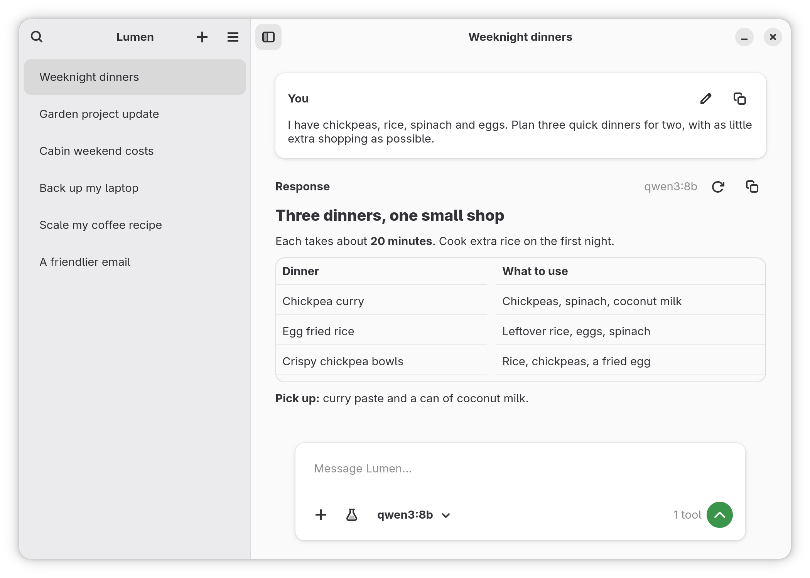
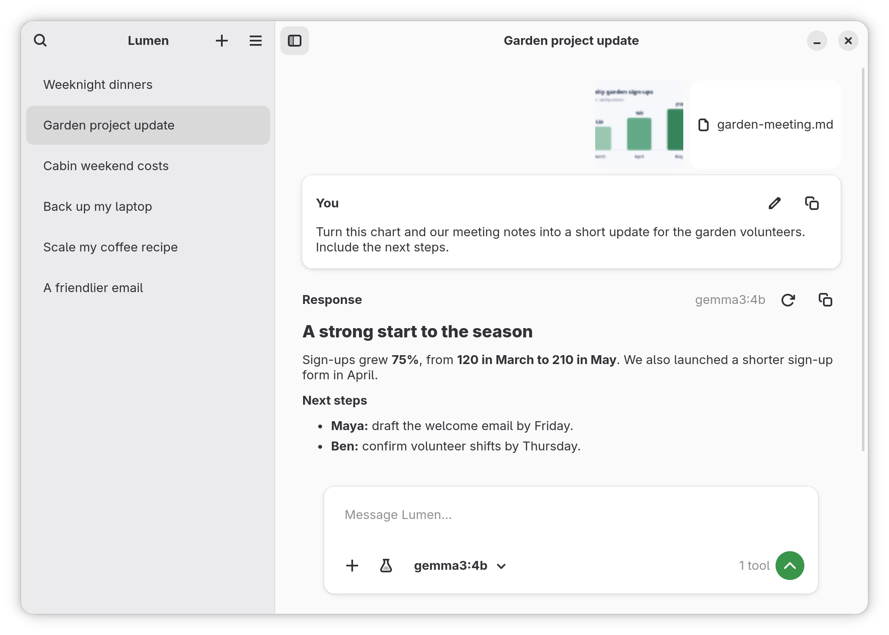
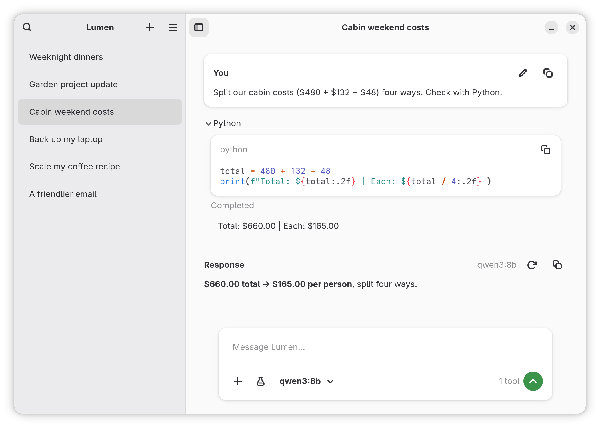
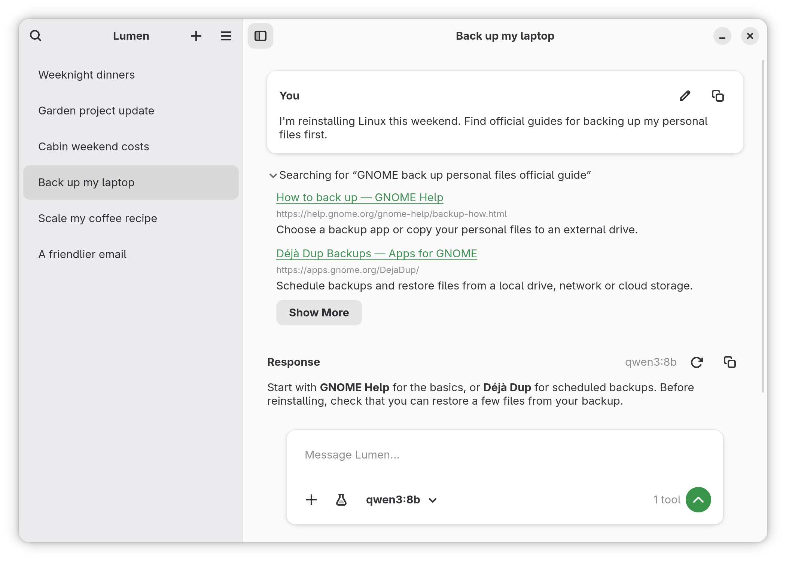
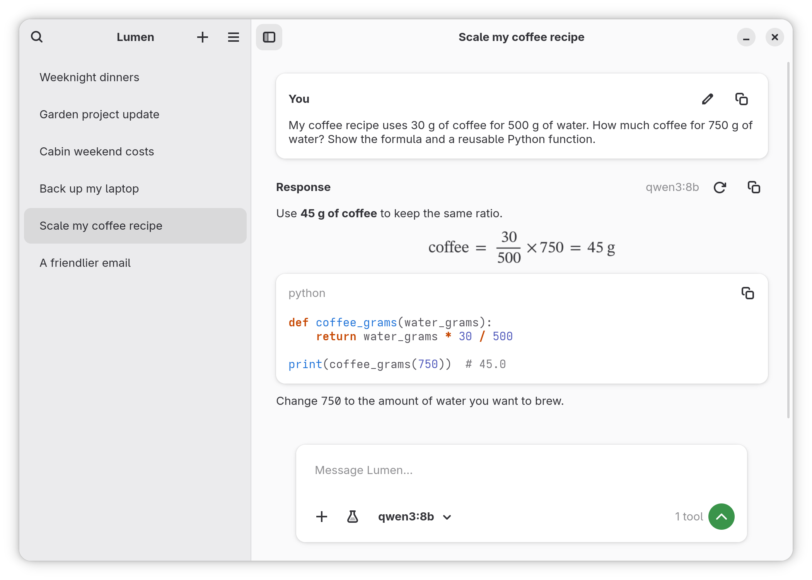
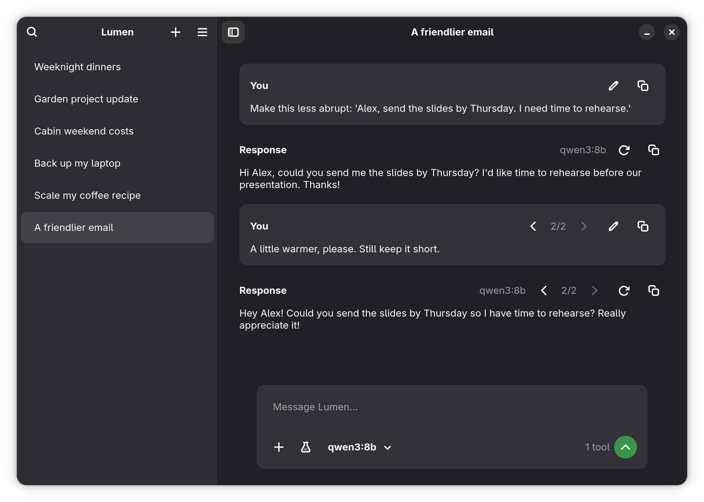
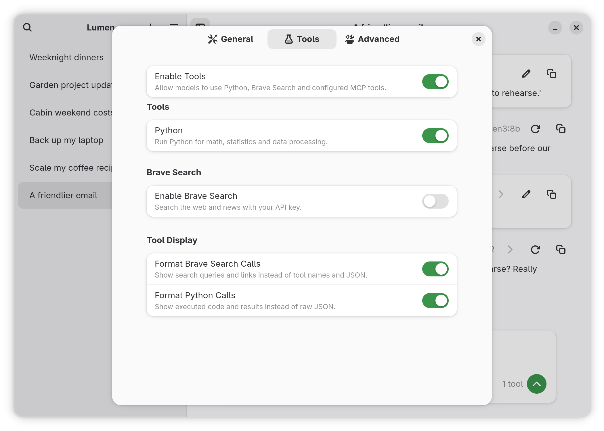

<div align="center">
  
  <h1>Lumen</h1>
  <p><strong>Your ideas. Your models. Your Linux desktop.</strong></p>
  <p>A comfortable place to chat with Ollama, work with files, and get everyday things done.</p>
  <p><a href="https://github.com/wfoyt/Lumen/releases/latest">Download Lumen</a> · <a href="#get-started">Get started</a> · <a href="#what-you-can-do">Explore the features</a> · <a href="https://github.com/wfoyt/Lumen/issues">Get help & share ideas</a></p>
</div>



*Turn “what's in the cupboard?” into a plan for the week. Lumen brings clear answers, useful tools, and your own models together in a native GNOME app.*

## What you can do

| You want to… | Lumen helps you… |
|---|---|
| Make everyday tasks easier | Plan meals, draft an email, brainstorm ideas, or ask a follow-up |
| Work with your own material | Attach pictures, PDFs, notes, code, and CSV files; preview them inside the app |
| Find something online | Search the web and news with optional Brave Search, then open the source links |
| Check the numbers | Run Python for calculations, statistics, and text processing |
| Understand code or a formula | Read highlighted code, formatted tables, and rendered equations; copy what you need |
| Try a different answer | Edit your question or regenerate with another model, keeping earlier versions |
| Keep things organized | Automatically save and name chats, search your history, and return to unfinished drafts |
| Make the app feel like yours | Use light or dark appearance, choose your tools, and add assistant instructions |

**Use Ollama on your computer or connect to your own server.** Your conversations are saved locally. Lumen needs a running Ollama service and a downloaded model; the model determines the quality of replies and which capabilities are available.

## Get started

### 1. Install Lumen

Lumen is available as a **Flatpak for Linux** from [GitHub Releases](https://github.com/wfoyt/Lumen/releases/latest).

1. [Set up Flatpak](https://flatpak.org/setup/) for your Linux distribution.
2. Download the latest `.flatpak` bundle. Choose `x86_64` for most Intel/AMD computers, or `aarch64` for ARM64 when available.
3. Open a terminal in the folder containing your download and install it. For the current x86_64 release:

```bash
flatpak install --user ./Lumen-0.1.2-x86_64.flatpak
```

Open **Lumen** from your application menu. Its interface, Python tools, and PDF preview dependencies are included or installed automatically by Flatpak.

To update, download the latest bundle and install it the same way, using the new filename.

### 2. Connect your models

Install [Ollama for Linux](https://docs.ollama.com/linux) if you don't already have it, then download a model. For example:

```bash
ollama pull llama3.2
```

In Lumen's first-launch guide, choose **Use Default URL** for Ollama on this computer. For another computer, enter its Ollama server URL. Once a model is downloaded, choose **Refresh Models** in Lumen's main menu, then select a model beside the message box.

If Lumen cannot connect, make sure Ollama is running. You can start it with `ollama serve` if it isn't already running as a service, and check the server URL in **Preferences → Advanced**. The local default is `http://localhost:11434`.

### 3. Ask something useful

Try “Plan three dinners with what I already have,” paste a draft you'd like to improve, or use **+** to bring a file into the conversation. Replies appear as they're written. You can stop a reply at any time and keep chatting.

## Bring your files into the conversation

**Summarize a PDF, turn meeting notes into next steps, or ask about a picture.** Add files with **+**, or paste an image directly into your message. Click a sent attachment to open its preview without leaving Lumen.



*From a chart and a few notes to a clear update your team can use.*

- **Documents and text:** PDFs with selectable text, plain text, Markdown, source code, and CSV files.
- **Images:** PNG, JPEG, and WebP, including images pasted from the clipboard. Choose a model with image support to attach and discuss them.
- **Built-in previews:** view images, read text and code, and browse PDF pages inside the app.

Scanned PDFs need OCR text first, or you can attach their pages as images with a vision model. Lumen checks your selected model's image support and helps you choose a compatible one.

## Let Python check the numbers

**Split a weekend bill, compare totals, or work through a calculation.** Built-in Python is enabled by default. With a model that supports tools, the assistant can run code and use the result in its answer.



*Expand the Python activity to see the code, its completion status, and the result.*

Python runs in a temporary, isolated environment without internet access or access to your private app data. Toggle Python in **Preferences → Tools**, or choose individual available tools from the tools menu beside the message box. Larger outputs can be opened and copied in full.

## Search the web, with sources you can open

**Look up a guide or find current information without leaving your chat.** Optional Brave Search supports web and news searches. Lumen shows the query, readable results, and clickable source links; expand the activity to see what the model found.



*Find the original guide, then open the source to explore it yourself.*

To get started, enable **Brave Search** in **Preferences → Tools**, add your key from the [Brave Search dashboard](https://api-dashboard.search.brave.com/), and select **Test Brave Search**. You'll need a model that supports tools. Searches use your Brave Search API plan.

## Read code and equations comfortably

**Work through a formula or ask for a reusable snippet.** Lumen renders inline and display equations alongside Markdown headings, lists, quotes, tables, and links. Code blocks have syntax highlighting, a copy button, and an option to expand longer snippets.



*A practical answer, the calculation behind it, and code you can reuse.*

Copy an entire reply or just the code you need. Equation rendering can be switched off in **Preferences → Advanced**. For models that return reasoning, **Show Model Thinking** in General preferences lets you view it in the conversation.

## Try another direction, keep your earlier answers

**Make a draft friendlier, refine your question, or compare models.** Use the edit button on your message or the regenerate button on a reply. You can choose another installed model for the new answer and use the version arrows to revisit earlier results and continue from the one you prefer.



*Two ways to say it, with both versions kept in the same conversation.*

Conversations save automatically and can receive a short model-generated title. Rename or delete a chat from its options menu. Search by title, message text, or attachment name. Unsent drafts stay available as you move between conversations, and a desktop notification lets you know when a reply finishes while the window is inactive.

## Make Lumen yours

Lumen follows your desktop's light or dark appearance and adapts to smaller windows. Preferences keep everyday choices close at hand:

- **General:** automatic chat titles and optional model thinking.
- **Tools:** Python, Brave Search setup and testing, and readable or raw tool activity.
- **Advanced:** your Ollama connection, equation rendering, custom assistant instructions, and custom MCP servers.



For extra integrations, enable **Edit Custom MCP Configuration** in **Preferences → Advanced**. MCP (Model Context Protocol) lets a model use tools supplied by another service. Lumen supports command-based servers and Streamable HTTP servers; see the [example configuration](data/mcp.example.json). For Flatpak, HTTP servers are usually easiest because programs installed on your computer aren't automatically available inside the sandbox.

Only enable tools you trust: your model can call enabled tools without asking for permission each time.

### Keyboard shortcuts

| Shortcut | Action |
|---|---|
| **Enter** | Send your message |
| **Shift+Enter** | Add a new line |
| **Ctrl+N** | Start a conversation |
| **Ctrl+F** | Search conversations |
| **Ctrl+,** | Open Preferences |

## Your data and privacy

Chats, attachments, and settings are stored on your computer. Messages and attached content are sent to the Ollama server you choose, including a remote server if you configure one. Brave Search sends search queries to Brave; custom MCP tools may send data to their configured services. API keys are stored as plain text in a private settings file.

You select files through the file picker. The Flatpak does not request access to your entire home folder. Its data lives here:

```text
~/.var/app/io.github.ollamagnome.Lumen/data/ollama-gnome/
```

**Reset to Default Settings** restores preferences and removes keys and custom MCP configurations while keeping chats. **Reset All Data** removes Lumen's chats, attachments, drafts, keys, and settings. Neither removes Ollama or its downloaded models.

## Help, feedback, and screenshots

Found a bug or have an idea? [Open an issue](https://github.com/wfoyt/Lumen/issues) and include your Lumen version, Linux distribution, and what you expected to happen. Keep private conversations and API keys out of reports.

All images above are captures of the real app with fictional sample conversations. **[Browse or download the screenshot set](docs/screenshots/README.md)** for the full-resolution PNGs, captions, and notes for a future Flathub listing.
